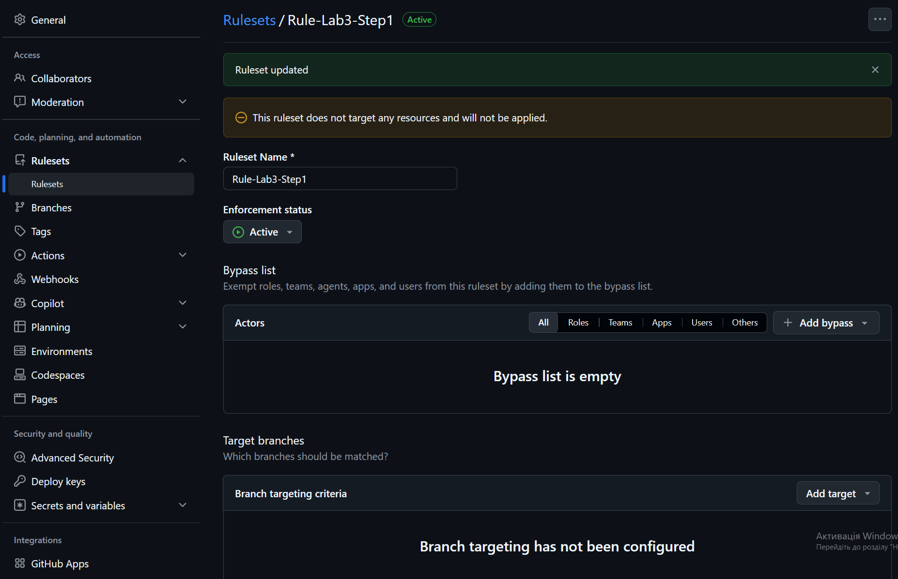
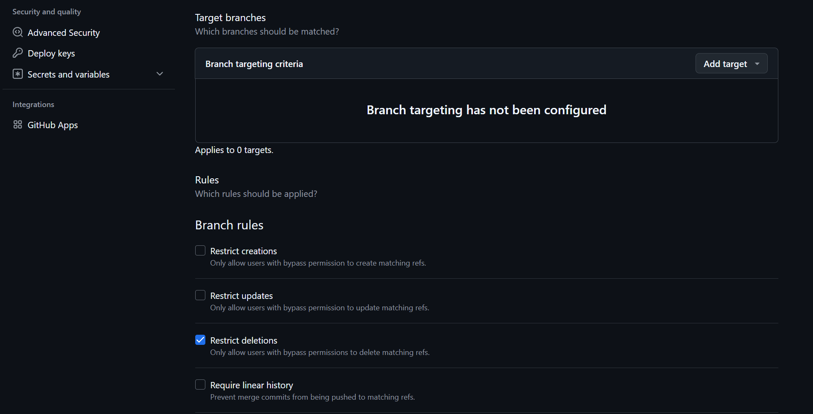
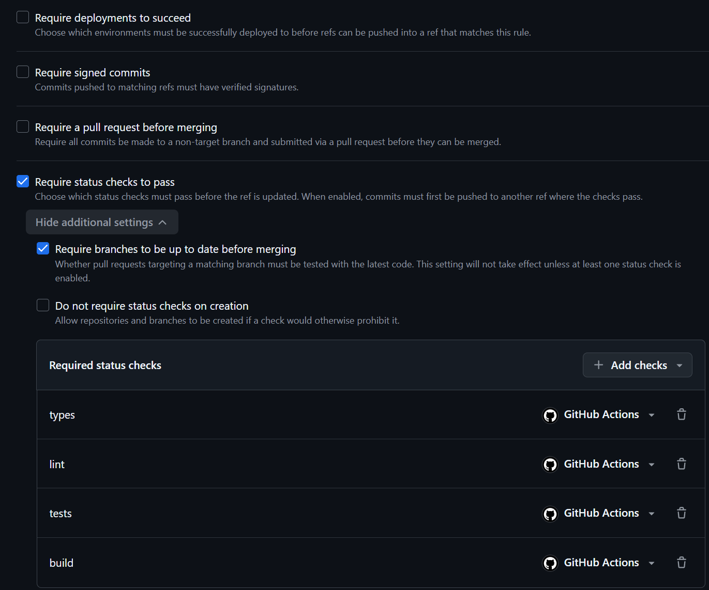

# Ланцюг детермінованих брам

- **Workflow:** `.github/workflows/gates.yml`
- **Порядок:** `types` → `lint` → `tests` → `build` → `record`
- **Чому такий порядок:** Брама детермінована й швидка стоїть першою. `types` (статична типізація TypeScript) коштує ~5–10 секунд і дає 100% однозначну відповідь щодо порушення типів та контрактів. Якщо типи зламані, виконання зупиняється миттєво, не спалюючи безкоштовні хвилини раннера на подальші етапи (`lint` ~15 с, `tests` ~15–20 с, `build` ~40 с). Поки `types` червоні, жодна наступна дія не запускається.
- **Concurrency:** `group: ${{ github.workflow }}-${{ github.ref }}`, `cancel-in-progress: true` (новий push у ту саму гілку негайно скасовує попередній прогін).
- **Артефакти:** `actions/upload-artifact@v7` (у брамах) / `actions/download-artifact@v8` (у задачі record).

---

## 1. Таблиця брам

| Брама | Що доводить | Чого коштує (ліміт / факт) | Що пише |
|---|---|---|---|
| **types** | Відповідність коду суворому TypeScript (`strict`), цілісність інтерфейсів та моделей даних. | 5 хв / ~8 с | `$GITHUB_OUTPUT`: `verdict=pass` + повний лог tsc |
| **lint** | Відповідність стилю коду, відсутність невикористаних змінних та небезпечних антипатернів ESLint. | 5 хв / ~15 с | `$GITHUB_OUTPUT`: `verdict=pass` + лог eslint |
| **tests** | Функціональну коректність бізнес-логіки та утиліт (155 офлайн-тестів Vitest). | 10 хв / ~15 с | `$GITHUB_OUTPUT`: `verdict=pass` + артефакт `gate-tests` |
| **build** | Можливість успішного продакшн-бандлінгу Next.js без конфліктів компонентів. | 15 хв / ~35 с | `$GITHUB_OUTPUT`: `verdict=pass` + артефакт `gate-build` (`.next/**`) |
| **record** | *Не є брамою, свідок.* Зводить результати всіх брам навіть при падінні (`if: ${{ !cancelled() }}`). | 5 хв / ~5 с | Артефакт `gate-record.json` + оновлення поля `gates` у `run.json` |

---

## 2. Обовʼязкові перевірки

- **Набір правил (Ruleset) на гілку `main`:** налаштовано політику *«Require status checks to pass before merging»*.
- **Перелічені перевірки:** `types`, `lint`, `tests`, `build`.
- **Вимога актуальності гілки:** опція *«Require branches to be up to date before merging»* увімкнена. Це запобігає злиттю застарілого коду, гарантуючи проходження брам саме на свіжій версії `main`.
- **Скріншоти налаштування правил захисту:**
  - `docs/lab3/gates-rule/gates-rule-1.png` — загальний стан ruleset для захисту гілки `main`.
  - `docs/lab3/gates-rule/gates-rule-2.png` — увімкнення перевірки статусу перед злиттям.
  - `docs/lab3/gates-rule/gates-rule-3.png` — список обов'язкових перевірок (`types`, `lint`, `tests`, `build`).





---

## 3. Навмисне падіння

- **Гілка:** `harness/red-2026-10-28`
- **Що саме зламано:** У файлі `src/broken-type.ts` навмисно створено невідповідність типів: змінній з типом `number` призначено рядковий літерал (`brokenTypeCheck: number = '...'`), що викликало помилку компілятора `TS2322: Type 'string' is not assignable to type 'number'`.
- **Прогін CI:** [https://github.com/Volodymyr-Is/AI-41-Agents-Project/actions/runs/40743771748](https://github.com/Volodymyr-Is/AI-41-Agents-Project/actions/runs/40743771748)
- **Очікувано червона брама:** `types` (статус `failure`, тривалість 12 с).
- **Що показали наступні брами:** `lint`, `tests`, `build` отримали статус **`skipped`** (а не `failure`), що підтверджує коректне блокування ланцюга через зв'язки `needs`.
- **Чи виконалась задача record:** **Так**, завдяки умові `if: ${{ !cancelled() }}`.
- **Витяг з артефакту `gate-record.json`:**
```json
{
  "task_id": "t-01",
  "artifact_dir": "runs/t-01-1793125614234",
  "gates": {
    "types": "fail",
    "lint": "skipped",
    "tests": "skipped",
    "build": "skipped"
  },
  "ci_run_url": "https://github.com/Volodymyr-Is/AI-41-Agents-Project/actions/runs/40743771748"
}
```

---

## 4. Звʼязок із фабрикою

Вердикти детермінованого ланцюга брам прив'язуються до найновішого артефакту прогону фабрики задач у каталозі `docs/lab3/runs/`:
- **Task ID:** `t-01`
- **Каталог артефакту:** `docs/lab3/runs/t-01-1793125614234/`
- **Фіксація у `run.json`:**
  На зеленому прогоні на гілці `main` скрипт `scripts/harness/record-gates.mjs` автоматично заповнює об'єкт `gates`:
  ```json
  "gates": {
    "types": "pass",
    "lint": "pass",
    "tests": "pass",
    "build": "pass"
  }
  ```
  Таким чином, журнал роботи агента і статуси детермінованих перевірок зведені в єдиний структурований доказ.

