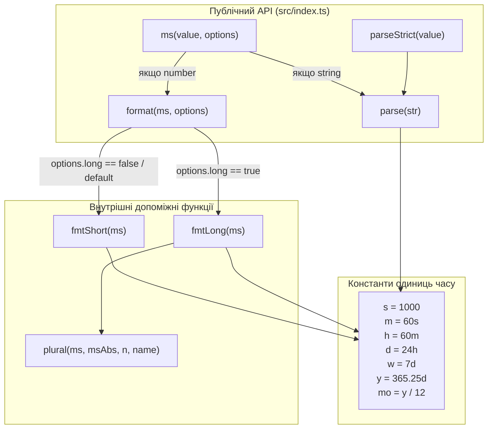

# Відновлений контекст: ms (Vercel)
- Дата: 2026-11-21
- Оригінал: [https://github.com/vercel/ms](https://github.com/vercel/ms) · мій форк: [https://github.com/Volodymyr-Is/ms](https://github.com/Volodymyr-Is/ms)
- Ліцензія: MIT, файл: [LICENSE](https://github.com/Volodymyr-Is/ms/blob/4ff48cec099f0514c3e9bbca18706c9c21122bfb/LICENSE)
- Нульова точка (SHA базового коміту форка): `4ff48cec099f0514c3e9bbca18706c9c21122bfb`
- Node у мене: `v24.11.0` · Node, якого просить проєкт (engines): `>=20`
- Режим читання агента: `Read-Only Plan / Explore` (жодних модифікацій файлів вихідного коду чужого репозиторію)

## 1. Що проєкт робить
`ms` — це мікробібліотека від Vercel для двосторонньої конвертації інтервалів часу між людиночитними рядками (наприклад, `"2 days"`, `"10h"`, `"-1.5 mins"`) та числовим значенням у мілісекундах (`172800000`, `36000000`). Бібліотека призначена для розробників бекенду, CLI та фронтенд-застосунків, де конфігурації таймаутів і кешування задаються у зрозумілому для людини форматі. Результат повертається або як число мілісекунд (при парсингу), або як форматований рядок у короткому чи повному стилі (при форматуванні).

## 2. Як його запустити й протестувати
| крок | команда дослівно | код виходу | що побачив |
|---|---|---|---|
| встановлення | `npx pnpm@10.33.0 install` | 0 | 410 пакетів встановлено, husky налаштовано, warnings відсутні (тривалість 13.8 с) |
| запуск (збірка) | `npx pnpm@10.33.0 run build` | 0 | `tsdown` скомпільовано ESM-бандл у `dist/index.js` та типи `dist/index.d.ts` |
| тести | `npx pnpm@10.33.0 test` | 0 | 4 тестові сюїти, 167 тестів успішно пройдено в Node.js та Edge середовищах, 100% line coverage |
| що перевіряє CI | `.github/workflows/test.yml`: `pnpm run test:nodejs`, `pnpm run test:edge` на Node 20, 22, 24. `.github/workflows/quality.yml`: `pnpm run format`, `pnpm run lint`, `pnpm run typecheck`, `pnpm run attw` на Node 24. | — | Повний ланцюг перевірок якості, сумісності типів та тестів |

## 3. Пʼять файлів, що мають значення
| файл (permalink) | чому саме він | звідки знаю |
|---|---|---|
| [`package.json`](https://github.com/Volodymyr-Is/ms/blob/4ff48cec099f0514c3e9bbca18706c9c21122bfb/package.json) | Головний маніфест: оголошує ESM-експорти, `engines: >=20`, залежності та команди | 74 коміти в історії (найчастіше змінюваний файл репозиторію) |
| [`src/index.ts`](https://github.com/Volodymyr-Is/ms/blob/4ff48cec099f0514c3e9bbca18706c9c21122bfb/src/index.ts) | Єдиний модуль бізнес-логіки: містить реалізацію `ms`, `parse`, `format`, `parseStrict` | 15 комітів в історії, точка входу всього коду бібліотеки |
| [`src/index.test.ts`](https://github.com/Volodymyr-Is/ms/blob/4ff48cec099f0514c3e9bbca18706c9c21122bfb/src/index.test.ts) | Інтеграційний тестовий набір для перевірки поліморфної функції `ms()` | 8 комітів в історії, ключова точка перевірки API |
| [`pnpm-workspace.yaml`](https://github.com/Volodymyr-Is/ms/blob/4ff48cec099f0514c3e9bbca18706c9c21122bfb/pnpm-workspace.yaml) | Конфігурація менеджера пакетів pnpm 10 (`onlyBuiltDependencies`, `minimumReleaseAge`) | Визначає правила збірки залежностей у pnpm |
| [`.github/workflows/test.yml`](https://github.com/Volodymyr-Is/ms/blob/4ff48cec099f0514c3e9bbca18706c9c21122bfb/.github/workflows/test.yml) | Матричний конвеєр безперервної інтеграції (Node 20, 22, 24) | Задає обов'язкові перевірки для pull request |

## 4. Карта залежностей цільового модуля (`src/index.ts`)
Модуль `src/index.ts` спроєктовано автономним: він **не має жодних зовнішніх сторонніх runtime-залежностей** (zero external dependencies).

## 5. Зони ризику та складності
1. **Регулярний вираз парсингу рядків:** У функції `parse()` використовується складний регекс із named capture groups (`value`, `unit`). Потенційний ризик некоректного розбору на граничних числових значеннях (наприклад, експоненційний запис на кшталт `1e3` або кілька пробілів).
2. **Абсолютні величини та переповнення:** Форматування від'ємних значень спирається на `Math.abs(ms)`, проте при округленні `Math.round(ms / n)` у `plural()` є ризик отримання `-0` у рядок (`"-0 days"`).
3. **Обмеження довжини вхідного рядка:** Жорстка перевірка `str.length > 100` кидає виняток, що може бути неочікуваним для споживачів бібліотеки, якщо рядок містить випадкові хвостові пробіли.

## 6. Три твердження про те, як код працює (із permalinks)
1. **Валідація довжини рядка:** Функція `parse()` генерує помилку `Error`, якщо переданий рядок порожній або його довжина перевищує 99 символів:  
   👉 [src/index.ts#L67-L71](https://github.com/Volodymyr-Is/ms/blob/4ff48cec099f0514c3e9bbca18706c9c21122bfb/src/index.ts#L67-L71)
2. **Парсинг числових значень та одиниці за замовчуванням:** Рядок розбирається регулярним виразом на значення та одиницю, причому якщо одиницю не вказано (наприклад `"100"`), за замовчуванням підставляється `'ms'`:  
   👉 [src/index.ts#L72-L85](https://github.com/Volodymyr-Is/ms/blob/4ff48cec099f0514c3e9bbca18706c9c21122bfb/src/index.ts#L72-L85)
3. **Правило множини у функції `plural()`:** Множина додає суфікс `'s'` до назви одиниці часу лише тоді, коли абсолютне значення перевищує або дорівнює $1.5 \times n$ (наприклад, `1.5 day` форматується як `"2 days"` завдяки `Math.round(ms / n)`):  
   👉 [src/index.ts#L280-L283](https://github.com/Volodymyr-Is/ms/blob/4ff48cec099f0514c3e9bbca18706c9c21122bfb/src/index.ts#L280-L283)

## 7. Три питання, на які відповіді не знайдено
1. Чому константа тривалості місяця розрахована строго математично як `mo = y / 12 = (d * 365.25) / 12` ($30.4375$ днів), тоді як у реальних календарях місяць триває від 28 до 31 дня?
2. Чому у функції `parse()` максимальна довжина рядка обмежена саме 99 символами (`str.length > 100` кидає помилку) — чи це превентивний захист від регулярних ReDoS-атак?
3. Чому функція не підтримує мікросекунди (`µs` або `us`) та наносекунди (`ns`), хоча сучасні середовища виконання Node.js підтримують високу роздільну здатність таймерів (`process.hrtime`, `performance.now()`)?
